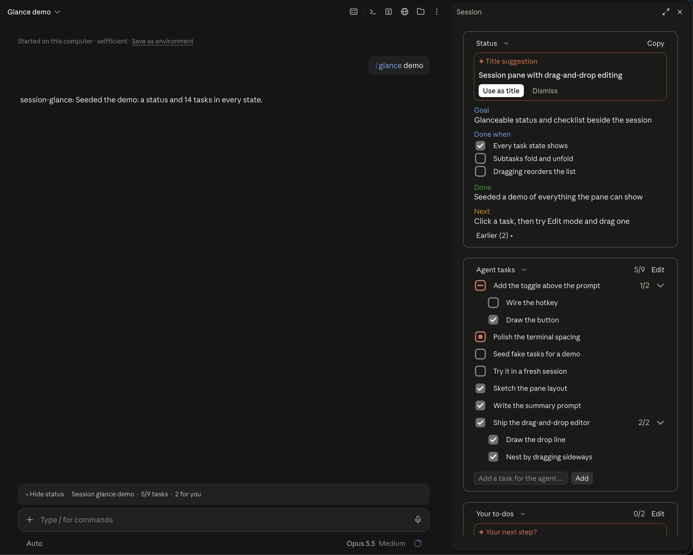
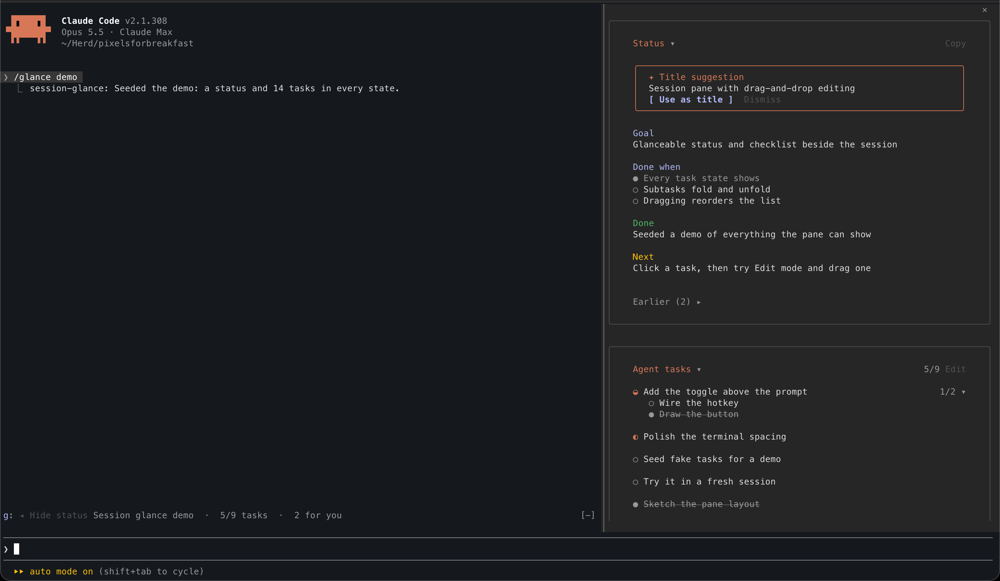
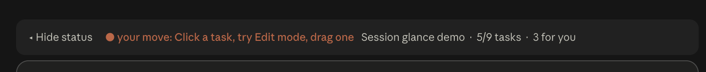
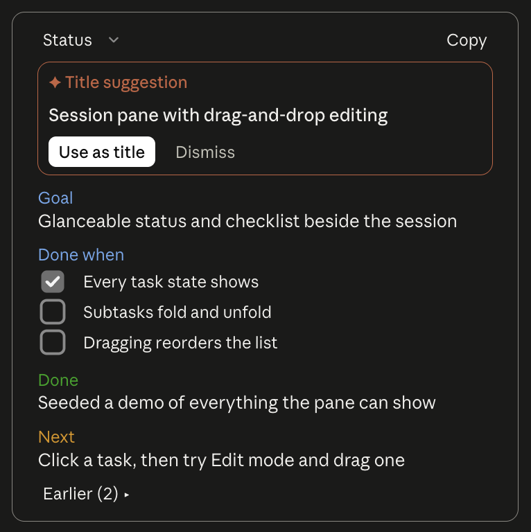
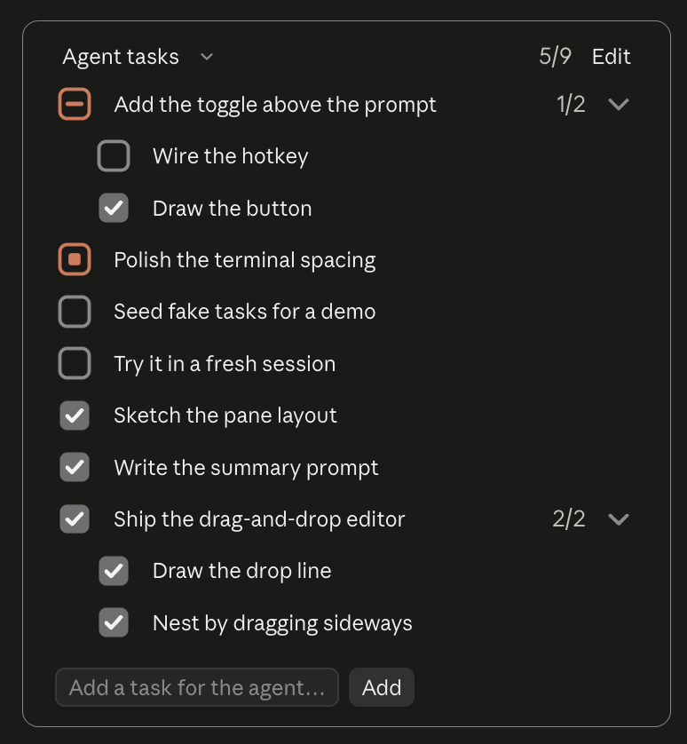
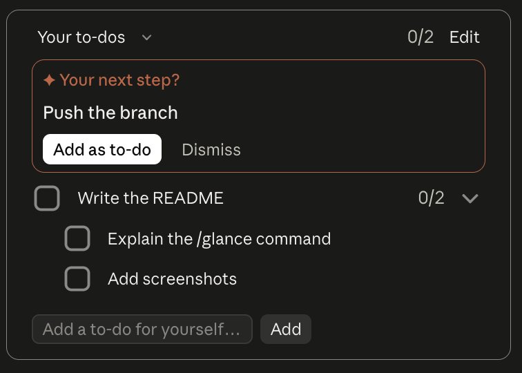
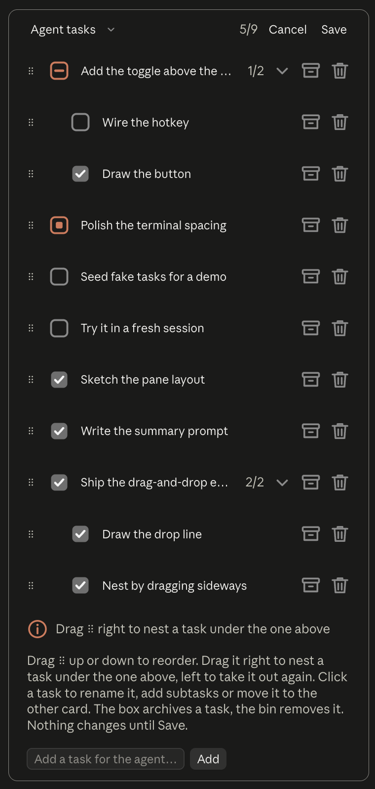
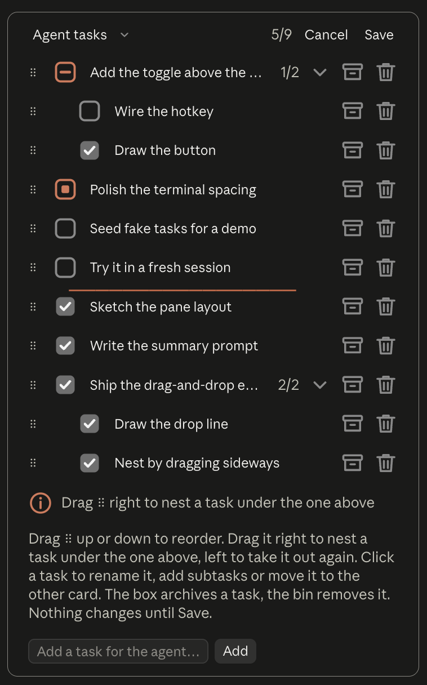
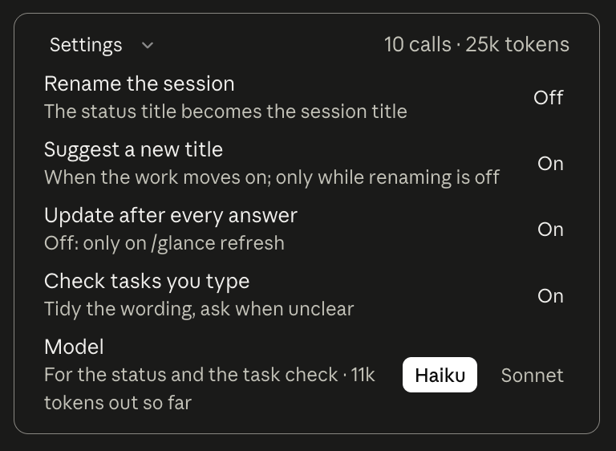

# session-glance

A pane beside the Claude Code chat that shows where a session stands, without asking the agent and spending a turn on it:

- **Status:** a rolling summary after every answer: goal, done-when criteria, what was just done, what is next, and a quiet line when a turn drifted off the goal.
- **Agent tasks:** a checklist that fills itself from the agent's own task tools (`TaskCreate`, `TaskUpdate` and `TodoWrite` in the terminal; the desktop app's own task list, `update_plan`, in its Code tab), with subtasks, progress and an Edit mode.
- **Your to-dos:** what you have to do yourself (push, review, decide, test by hand), with the next step suggested from the conversation.



## Install

At the prompt of a terminal session:

```
/plugin install session-glance --marketplace pixels-for-breakfast/claude-code-mods
```

From a shell:

```bash
claude plugin install session-glance --marketplace pixels-for-breakfast/claude-code-mods
```

In the desktop app, where `/plugin` does not run: click + next to the prompt box, then Plugins, Add marketplace with `pixels-for-breakfast/claude-code-mods`, then Add plugin.

## Using it

The pane opens at the start of a session. Toggle it with `/glance`, or with the **Show status / Hide status** button above the prompt (`g` in the terminal).



When a turn ends and the next step is yours, the band says so in the accent colour: **● your move: push develop**, or **● your move: answer the question** when the answer ends on one. It shows only between turns and goes away at your next prompt, so you can see it without opening the pane.



While text is selected on screen, **+ Task** and **+ To-do** appear beside that button: they add the selection as a task for the agent or as a to-do of your own, through the usual task check. The selection is checked a few times a second, because Claude Code raises no event when it changes; where a surface does not report its selection, the buttons stay hidden.

| Command | What it does |
| --- | --- |
| `/glance` | Opens or closes the pane |
| `/glance copy` | Copies the status and both checklists as markdown, for a PR description, a standup or the next session; prints it where no clipboard is reachable |
| `/glance task` | Adds the selected text as a task for the agent |
| `/glance todo` | Adds the selected text as a to-do of your own |
| `/glance refresh` | Updates the status from the last answer (for when automatic updates are off) |
| `/glance purge` | Clears the status, title and every task, after asking |
| `/glance demo` | Fills the pane with a demo of every state it can show |

**Status card**

<p></p>

- **Done when** is a list of 1–4 criteria. The model marks them met as the work goes on; click one to tick or untick it yourself. A criterion you ticked stays met. When all are met, the card says the goal is reached.
- **Off goal** appears when the last turn did something other than the goal. It never interrupts the agent.
- **Earlier (n)** keeps what each earlier turn did (its Done line, numbered by prompt), newest first, so after a `/resume` you can see how the session got here. It holds the last 50 and is saved with the pane.
- **Copy** puts the same markdown as `/glance copy` on the clipboard.
- **Title suggestion** appears when the session's work as a whole has moved away from its title. **Use as title** sets it as the session title at your next prompt; **Dismiss** keeps it from being offered again.

**Agent tasks and Your to-dos**

<p> </p>

- Two cards: the agent's tasks, and the things you have to do yourself. Each has its own progress count; the band above the prompt shows the agent's count and how many to-dos are open for you.
- Click a task to mark it done, start it or reopen it. A main task with subtasks shows how many are done, and its state follows them.
- **Edit** opens Edit mode in that card (one card at a time): drag `⠿` to reorder, drag sideways to nest a task under the one above or take it out again, click a task to rename it, add subtasks or move it to the other card (a main task takes its subtasks along), archive it with the box or remove it with the bin at the end of its row. Nothing changes until **Save**.

  <p> </p>

- Archived tasks leave the card and its count, and wait under **Archived (n)** at the bottom of the card, with **Restore** for each. An archived task of the agent's stays archived when it rewrites its list.
- Each card has its own add field. The model tidies the wording and asks when it is unclear or a duplicate.
- **Your next step?** appears in your card when the conversation leaves the next move to you, such as pushing a branch or answering a question. **Add as to-do** puts it in your to-dos; **Dismiss** keeps it from being offered again.
- Every change you make is passed to the agent, so it works from the same lists. A to-do in your card reaches it as a note, not as work for it.

**Open to-dos carry over.** When a new session starts in a project where an earlier session left to-dos of yours open, your card offers them: **Bring them** adds them (with their open subtasks) and tells the agent they are yours; **Dismiss** leaves them behind. The earlier session keeps its own copy.

The pane is saved per session: `/resume` and a restart bring it back, `/clear` starts it empty. A compaction is told to keep the goal and done-when.

## Settings

Set them in the **Settings** card at the bottom of the pane, in the config menu (`/config`), or with the commands below. A change reloads the mod; the pane keeps what it shows.

<p></p>

| Setting | Default | Command | What it does |
| --- | --- | --- | --- |
| Rename the session (`renameSession`) | off | `/glance rename on\|off` | Sets the session's title to the status title at every prompt |
| Suggest a new title (`suggestTitle`) | on | `/glance suggest on\|off` | Suggests a title when the work moves away from the current one; only while renaming is off |
| Update the status after every answer (`autoSummary`) | on | `/glance auto on\|off` | Off: the status only changes on `/glance refresh` |
| Check tasks you type (`checkTasks`) | on | `/glance check on\|off` | Off: typed tasks are added as typed, without a model call |
| Model (`summaryModel`) | `haiku` | `/glance model haiku\|sonnet` | The model for the status and the task check |

## Privacy and cost

The status and the task check are model calls made through your own Claude Code account, the same way your session's own calls are:

- **After each answered turn** (unless automatic updates are off): the previous status, your last prompt (first 4,000 characters) and the answer (first 8,000 characters). Subagent turns are skipped.
- **When you add or rename a task** (unless the task check is off): the typed text, the session goal and the current task list.

**What it costs.** Measured over 57 calls in five working sessions (October 2026, Haiku): a call takes about 1,200 tokens in and 1,100 out, so about **$0.0007 a call, or 7 cents per 100 answered turns**, at Haiku 5.5's API price ($0.10 / $0.50 per million tokens). Most of the output is the model's thinking, which is billed as output. With Sonnet 5.5 ($2 / $10) the same calls come to about $0.013 each, $1.34 per 100 turns. Expect one call per answered turn, plus one for each task you type or rename. On a Claude subscription the calls count toward your usage instead of being billed.

Nothing is sent anywhere else. The **Settings** card's header counts every call and its tokens this session. The pane's saved state (status, title, tasks, history and counts, for the 30 most recent sessions, with each session's project folder so a new session can offer what was left open) is kept in the plugin's own store in your Claude Code configuration folder.

## Development

```bash
claude --plugin-dir plugins/session-glance      # run it from this folder
claude plugin validate plugins/session-glance
claude plugin test plugins/session-glance
```

- `hooks/register.tsx`: the state, the actions that change it, and the events (the engine's scan only accepts state that is read and written in the file that defines it).
- `hooks/pane.tsx`: the pane and the band, drawn from plain data and a set of actions; no state.
- `hooks/status.ts`: reading the status the model writes (fields, criteria, drift, suggestions) and the markdown handoff.
- `hooks/prompts.ts`: the prompts for the status and the task check, and reading their replies.
- `hooks/tree.ts`: the pure task logic (display order, progress, drag-and-drop, owners, archive, what an edit changed).
- `hooks/task-list.tsx`: the drag layer of Edit mode.
- `hooks/icons.ts`, `hooks/settings.ts`, `hooks/demo.ts`: pictures, the settings table, the demo.
- `types/index.d.ts`: the state contract.
- `tests/`: `glance.test.tsx` (pane and band), `manage.test.tsx` (Edit mode), `features.test.tsx` (persistence, criteria, copy, settings, title suggestions).

Built against Claude Code 2.1.308. The tests draw the pane for the terminal and the desktop app.

## Changes

See [CHANGELOG.md](CHANGELOG.md).

## Licence

MIT, see [LICENSE](../../LICENSE).
